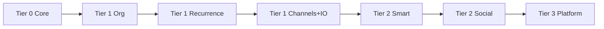

# Day Remind — Implementation Plan (Expanded)

> **For agentic workers:** REQUIRED SUB-SKILL: Use superpowers:subagent-driven-development (recommended) or superpowers:executing-plans to implement this plan task-by-task. Steps use checkbox (`- [ ]`) syntax for tracking.

**Goal:** Build **Day Remind** — a full-featured reminder platform with multi-channel delivery, recurrence, advance alerts, organization (tags/lists), calendar UI, NL parsing, sharing, and calendar sync.

**Architecture:** Modular Go monolith (API + scheduler + channel adapters + embedded PWA), Postgres, optional S3 for attachments, optional Redis when splitting workers.

**Design docs:**
- Product: [`docs/superpowers/specs/2026-09-11-day-remind-design.md`](../../specs/2026-09-11-day-remind-design.md)
- **UI:** [`docs/superpowers/specs/2026-09-11-day-remind-ui-design.md`](../../specs/2026-09-11-day-remind-ui-design.md)

**Tech Stack:** Go 1.22+, Postgres 16, chi, Resend, Telegram, Twilio (Tier 1), Web Push, S3, Gemini/Groq (Tier 2), embedded Bootstrap PWA.

## Global Constraints

- Repository: **`day-remind`** (`github.com/shivam-20/day-remind`).
- Timestamps stored UTC; display in user `timezone`.
- Idempotency key: `{occurrence_id}:{channel}`.
- Sessions: HttpOnly cookie; API keys: Bearer for automation (Tier 1).
- All reminder reads/writes enforce `user_id` or share ACL.
- RRULE: store string, expand via `github.com/teambition/rrule-go` or equivalent.
- Static UI: `//go:embed` — rebuild after `static/` edits.
- Channel adapter interface required from day one (easy to add SMS, Slack, etc.).

---

> Status: **plan only** — repo not scaffolded.  
> Spec revision: **4** (UI design spec + implementation phases).

## Release roadmap



| Phase | Tier | Theme | Key deliverables |
|-------|------|-------|------------------|
| 0 | — | Scaffold | Repo, DB, CI, health |
| 1 | 0 | Auth + reminders | CRUD, markdown description, in-app notifications |
| 2 | 0 | Delivery | Scheduler, email + Telegram, snooze presets, delivery log |
| 3 | 0 | Telegram + PWA shell | Bot commands, service worker stub, dark theme |
| 4 | 1 | Organization | Tags, lists, priority, search, dashboard widgets |
| 5 | 1 | Calendar + subtasks | Month/week UI, drag reschedule, checklists |
| 6 | 1 | Recurrence + offsets | RRULE, advance alerts, occurrence materialization |
| 7 | 1 | Channels + overrides | Web push, SMS, Slack; per-reminder channel pick |
| 8 | 1 | Import/export + API | **JSON**, CSV, iCal, templates, personal API keys |
| 8b | 0–1 | Pause | Reminder, list, vacation mode; scheduler gates |
| 11 | 1–2 | Google (Gmail) | OAuth, calendar + Gmail sync, pause per integration |
| 9 | 2 | NL + ingest | Gemini parse endpoint, email-to-remind, morning digest |
| 10 | 2 | Sharing + groups | Invite, assignee, comments, escalation chain |
| 12 | 3 | Platform | Webhooks, admin console, 2FA, plan limits |

### UI track (runs parallel to backend phases)

| UI Phase | Pairs with | Deliverable |
|----------|------------|-------------|
| **UI-1** | Phase 0–1 | Design tokens, shell, login/signup |
| **UI-2** | Phase 1–2 | Today dashboard, reminder list, create drawer |
| **UI-3** | Phase 2–8b | Detail drawer, pause/vacation UX, settings hub |
| **UI-4** | Phase 4–5 | Calendar, lists, filters, command palette |
| **UI-5** | Phase 6–8 | Recurrence UI, offsets, Data import/export page |
| **UI-6** | Phase 11 | Google/Gmail settings page |
| **UI-7** | Phase 9–10 | NL quick-add, sharing UI, onboarding |
| **UI-8** | All | PWA polish, a11y audit, responsive QA |

---

## UI Phase UI-1: Design system + shell

**Spec:** [`2026-09-11-day-remind-ui-design.md`](../../specs/2026-09-11-day-remind-ui-design.md) § Visual design system, § File structure

**Files:**
- Create: `internal/web/static/css/theme.css`, `css/app.css`, `js/app.js`, `js/api.js`, `js/components.js`, `index.html`
- Create: `internal/web/static/icons/sprites.svg`

- [ ] **Step 1:** Port tokens from UI spec — dark default + `[data-bs-theme="light"]` in `theme.css` (Bell Amber accent, surfaces, semantic colors, spacing, type scale).
- [ ] **Step 2:** Base components in `components.js`: `showToast`, `confirmDialog` (focus trap), `openDrawer`/`closeDrawer`, `emptyState`, `skeletonRows`.
- [ ] **Step 3:** App shell `renderLayout()`: desktop sidebar nav; mobile bottom nav + FAB placeholder; topbar with search/bell slots; vacation banner slot.
- [ ] **Step 4:** Hash router: `#/today`, `#/reminders`, `#/calendar`, `#/lists`, `#/settings`, `#/login`.
- [ ] **Step 5:** Login/signup split-screen per wireframe; show/hide password; Google button placeholder.
- [ ] **Step 6:** Theme toggle in sidebar + `localStorage` `drTheme`; `initTheme()` on load.
- [ ] **Step 7:** Commit `feat(ui): design tokens and app shell`.

---

## UI Phase UI-2: Today + list + create

**Spec:** UI spec § Screen 2, 3, 5

**Files:**
- Create: `js/reminders.js`; Modify: `app.js`, `app.css`

- [ ] **Step 1:** **Today page:** overdue strip, greeting, timeline grouped by time-of-day, upcoming section, mini stat cards.
- [ ] **Step 2:** **Reminder card** component: list color stripe, time chip (mono), title, meta line, channel icons, `···` menu.
- [ ] **Step 3:** **All reminders page:** filter chips (All/Scheduled/Paused/Done/Overdue), search input, sort dropdown.
- [ ] **Step 4:** **Create drawer:** essentials (title, date, time, list); mobile → full sheet with sticky Save/Cancel footer.
- [ ] **Step 5:** Wire `POST/GET /api/reminders`; optimistic row insert + toast on success.
- [ ] **Step 6:** FAB on mobile opens create sheet; keyboard `n` opens create on desktop.
- [ ] **Step 7:** Empty states per UI spec for Today and All.
- [ ] **Step 8:** Responsive: table → cards at ≤768px.
- [ ] **Step 9:** Commit `feat(ui): today dashboard and reminder list`.

---

## UI Phase UI-3: Detail, pause, settings hub

**Spec:** UI spec § Screen 6, 9, 9c

**Files:**
- Create: `js/settings.js`; Modify: `reminders.js`, `app.css`

- [ ] **Step 1:** **Detail drawer** tabs: Details, Notifications (delivery log table), Activity.
- [ ] **Step 2:** Sticky actions: Done, Snooze dropdown, Pause/Resume, Edit, Delete (confirm dialog).
- [ ] **Step 3:** `.is-paused` styling + pause icon on cards; Paused filter chip works.
- [ ] **Step 4:** **Vacation banner** component — reads `/api/me` pause fields; Resume CTA.
- [ ] **Step 5:** **Settings hub** card grid (Profile, Notifications, Vacation, Google, Telegram, Data, Appearance, Account).
- [ ] **Step 6:** **Vacation & Pause** sub-page: toggle, resume date picker, list of paused reminders.
- [ ] **Step 7:** **Notifications** sub-page: channel toggles, quiet hours time inputs.
- [ ] **Step 8:** **Profile** sub-page: name, timezone select, avatar placeholder.
- [ ] **Step 9:** Commit `feat(ui): detail drawer pause and settings hub`.

---

## UI Phase UI-4: Calendar, lists, command palette

**Spec:** UI spec § Screen 4, 7, 10

**Files:**
- Create: `js/calendar.js`; Modify: `app.js`, `app.css`

- [ ] **Step 1:** Month grid: 7 cols, today ring, dots per day, click → side panel list.
- [ ] **Step 2:** Week view toggle + time grid (6am–10pm); drag block → PATCH `due_at`.
- [ ] **Step 3:** **Lists page:** color cards with counts; pause badge; click → filtered reminders.
- [ ] **Step 4:** Create/edit list modal — name + 8 color swatches.
- [ ] **Step 5:** **Command palette** overlay `Cmd+K`: fuzzy search reminders + nav actions; arrow keys + Enter.
- [ ] **Step 6:** In-app **notification bell** dropdown (wire to `/api/notifications` when API exists).
- [ ] **Step 7:** Commit `feat(ui): calendar lists and command palette`.

---

## UI Phase UI-5: Recurrence, offsets, Data page

**Spec:** UI spec § Screen 5 Step B, 9a

**Files:**
- Modify: `reminders.js`, `settings.js`, `app.css`

- [ ] **Step 1:** Create form **More options** `<details>`: description markdown preview, priority segmented control, tags chips.
- [ ] **Step 2:** Recurrence picker UI — presets + custom; edit-series radio on recurring edit.
- [ ] **Step 3:** Advance alerts UI — preset chips + custom offset row list.
- [ ] **Step 4:** Per-reminder channel override toggles in create/edit.
- [ ] **Step 5:** **Data page:** Export JSON/CSV/iCal buttons; last export timestamp; weekly backup checkbox.
- [ ] **Step 6:** Import **dropzone** + mode radio + Preview table + Import button; progress spinner.
- [ ] **Step 7:** Subtasks checklist UI in create/detail drawers.
- [ ] **Step 8:** Commit `feat(ui): recurrence offsets and data import export`.

---

## UI Phase UI-6: Google & Gmail settings

**Spec:** UI spec § Screen 9b

**Files:**
- Modify: `settings.js`, `app.css`

- [ ] **Step 1:** Google card — Connect / Disconnect; show connected email.
- [ ] **Step 2:** Calendar + Gmail rows: ON toggle, Pause button, last sync relative time.
- [ ] **Step 3:** Gmail label multi-select (Starred, Important, custom labels from API).
- [ ] **Step 4:** Sync now button + loading state + result toast.
- [ ] **Step 5:** Sync status pills: ok (green), paused (grey), error (red).
- [ ] **Step 6:** Commit `feat(ui): google gmail settings page`.

---

## UI Phase UI-7: Templates, NL, sharing, onboarding

**Spec:** UI spec § Screen 8, 12, Flow D

**Files:**
- Modify: `app.js`, `reminders.js`, `settings.js`

- [ ] **Step 1:** **Templates gallery** card grid; click opens pre-filled create drawer.
- [ ] **Step 2:** Quick-add **NL toggle** — single line input → `POST /api/reminders/parse` → preview card → confirm save.
- [ ] **Step 3:** 3-step **onboarding** coach marks (`localStorage`); dismiss + don’t show again.
- [ ] **Step 4:** Share reminder modal (Tier 2): email + permission; pending invites list.
- [ ] **Step 5:** Commit `feat(ui): templates nl onboarding sharing`.

---

## UI Phase UI-8: PWA + QA

**Spec:** UI spec § PWA shell, § QA viewports, § Accessibility

**Files:**
- Create: `manifest.json`, `sw.js`; Modify: `index.html`, `app.css`

- [ ] **Step 1:** PWA manifest + icons 192/512; `theme_color` Bell Amber.
- [ ] **Step 2:** Service worker — cache shell assets; network-first API.
- [ ] **Step 3:** Install prompt banner after 2nd visit.
- [ ] **Step 4:** Skip link, `aria-current`, focus rings audit, 44px touch targets on mobile.
- [ ] **Step 5:** `prefers-reduced-motion` — disable pulse/drawer animation.
- [ ] **Step 6:** Manual QA at 390/768/1440 × dark/light per UI spec matrix.
- [ ] **Step 7:** Optional: `node scripts/ui-audit.mjs` (port from expense-bot when app runs).
- [ ] **Step 8:** Commit `feat(ui): pwa and accessibility qa`.

---

## Phase 0–3 (Tier 0) — summary

Detailed step-by-step tasks for Phases 0–3 remain as in plan revision 1 (scaffold → auth → UI → scheduler → Telegram). **Additions for Tier 0:**

### Phase 1 additions

- [ ] `description` supports **markdown** (render in UI with marked.js or similar vendored lib).
- [ ] `priority` column default `normal`; expose in API (UI in Phase 4).
- [ ] `in_app_notifications` table + bell dropdown in header.
- [ ] Password reset flow (`forgot-password` email via Resend).

### Phase 2 additions

- [ ] Snooze presets API: `+15m`, `+1h`, `+3h`, `tomorrow_9am`, `custom`.
- [ ] `reminder_occurrences` table — fire engine uses occurrences not raw `due_at` only.
- [ ] Urgent priority bypasses quiet hours (configurable).
- [ ] **Pause:** `POST /api/reminders/{id}/pause|resume`; status `paused`; scheduler skips paused reminders.
- [ ] **Vacation mode:** `users.notifications_paused` + `notifications_paused_until`; `POST /api/me/notifications/pause|resume`.
- [ ] UI: pause icon on reminder row; settings banner when vacation mode active.

### Phase 3 additions

- [ ] Telegram: `/add`, `/list`, `/done`, `/snooze`, `/settings`, `/help`.
- [ ] PWA `manifest.json` + service worker (cache static shell).
- [ ] CSS theme toggle (dark/light) persisted in localStorage.

---

## Phase 4: Organization (Tier 1)

### Task 4.1: Lists and tags

**Files:**
- Create: `migrations/002_lists_tags.sql`, `internal/storage/lists.go`, `internal/storage/tags.go`, `internal/web/lists.go`, `internal/web/tags.go`

- [ ] **Step 1:** CRUD `/api/lists` — name, color, sort_order.
- [ ] **Step 2:** CRUD `/api/tags` — name unique per user.
- [ ] **Step 3:** `reminder_tags` M2M; PATCH reminder accepts `list_id`, `tag_ids[]`.
- [ ] **Step 4:** UI sidebar: lists with counts; tag chips on reminder rows.
- [ ] **Step 5:** `POST /api/lists/{id}/pause|resume` — sets `lists.paused`; scheduler skips reminders in paused lists.
- [ ] **Step 6:** Commit `feat: lists and tags with list pause`.

### Task 4.2: Search, filter, dashboard

**Files:**
- Modify: `internal/storage/reminders.go`, `static/js/app.js`

- [ ] **Step 1:** `GET /api/reminders?q=&list_id=&tag=&priority=&status=&from=&to=`.
- [ ] **Step 2:** Postgres `GIN` index on `to_tsvector(title || description)` for full-text.
- [ ] **Step 3:** `GET /api/stats/dashboard` → `{ overdue, today, upcoming_7d, streak, next_five[] }`.
- [ ] **Step 4:** Dashboard widgets: overdue banner (red), today list, next 5 cards.
- [ ] **Step 5:** Search bar with debounce; filter chips.
- [ ] **Step 6:** Commit `feat: search filters and dashboard`.

---

## Phase 5: Calendar view + subtasks (Tier 1)

### Task 5.1: Calendar API + UI

**Files:**
- Create: `internal/web/calendar.go`, `static/js/calendar.js`

- [ ] **Step 1:** `GET /api/calendar?from=2026-09-01&to=2026-09-30` → `[{ date, reminders[] }]`.
- [ ] **Step 2:** Month grid UI; click day → side panel list.
- [ ] **Step 3:** Week view toggle.
- [ ] **Step 4:** Drag reminder to new day → `PATCH` updates `due_at` (same time).
- [ ] **Step 5:** Commit `feat: calendar month and week views`.

### Task 5.2: Subtasks

**Files:**
- Create: `migrations/003_subtasks.sql`, `internal/storage/subtasks.go`, `internal/web/subtasks.go`

- [ ] **Step 1:** `GET/POST /api/reminders/{id}/subtasks`; PATCH toggle done; reorder.
- [ ] **Step 2:** Detail drawer checklist UI; progress bar (2/5).
- [ ] **Step 3:** Optional `require_all_subtasks` on reminder — block Done until all checked.
- [ ] **Step 4:** Commit `feat: subtask checklists`.

---

## Phase 6: Recurrence + advance alerts (Tier 1)

### Task 6.1: RRULE engine

**Files:**
- Create: `internal/recurrence/rrule.go`, `internal/recurrence/expand.go`
- Test: `internal/recurrence/expand_test.go`

- [ ] **Step 1:** Add dependency `github.com/teambition/rrule-go`.
- [ ] **Step 2:** On create/update with `recurrence_rule`, set `series_id` (first id in series).
- [ ] **Step 3:** After main occurrence fires + marked done, generate next `reminder_occurrence` from RRULE.
- [ ] **Step 4:** UI: recurrence picker (daily, weekly, monthly, yearly, custom); end after N or until date.
- [ ] **Step 5:** Edit dialog: “This event” vs “This and following” vs “All in series”.
- [ ] **Step 6:** Tests: daily, weekly MO-FR, monthly 31st edge case.
- [ ] **Step 7:** Commit `feat: recurring reminders`.

### Task 6.2: Advance notification offsets

**Files:**
- Create: `migrations/004_offsets.sql`, `internal/storage/offsets.go`, `internal/scheduler/offsets.go`

- [ ] **Step 1:** `reminder_offsets(reminder_id, offset_minutes, channel_override JSONB)`.
- [ ] **Step 2:** On reminder save, materialize occurrence rows for each offset + main due.
- [ ] **Step 3:** UI: “Remind me before” — presets 15m, 1h, 1d, 1w + custom.
- [ ] **Step 4:** Notification body prefix: “⏰ In 1 day:” vs “🔔 Now:”.
- [ ] **Step 5:** Commit `feat: advance alert offsets`.

---

## Phase 7: Extended channels (Tier 1)

### Task 7.1: Channel adapter framework

**Files:**
- Create: `internal/notify/sender.go`, `internal/notify/registry.go`

```go
type Sender interface {
    Channel() string
    Send(ctx context.Context, msg DeliveryMessage) error
}
```

- [ ] **Step 1:** Register senders: email, telegram, webpush, sms, slack.
- [ ] **Step 2:** `reminder_channel_overrides` table; merge logic in router.
- [ ] **Step 3:** Settings UI: connect each channel (phone for SMS, webhook URL for Slack).
- [ ] **Step 4:** Per-reminder “Notifications” tab — override toggles.
- [ ] **Step 5:** Commit `feat: pluggable channel adapters`.

### Task 7.2: Web push

**Files:**
- Create: `internal/notify/webpush.go`, `static/sw.js`, `internal/web/push.go`

- [ ] **Step 1:** Generate VAPID keys; `POST /api/push/subscribe` stores subscription JSON.
- [ ] **Step 2:** Service worker shows notification with actions Done/Snooze.
- [ ] **Step 3:** Commit `feat: web push notifications`.

### Task 7.3: SMS + Slack

**Files:**
- Create: `internal/notify/sms.go`, `internal/notify/slack.go`

- [ ] **Step 1:** Twilio send; store consent checkbox on enable.
- [ ] **Step 2:** Slack incoming webhook POST with blocks (title, description, buttons as links).
- [ ] **Step 3:** Commit `feat: sms and slack channels`.

---

## Phase 8: Import, export, templates, API keys (Tier 1)

### Task 8.1: Templates

**Files:**
- Create: `internal/storage/templates.go`, `migrations/005_templates.sql`, seed system templates

- [ ] **Step 1:** Seed: Birthday, Bill payment, Medicine, Meeting follow-up.
- [ ] **Step 2:** `GET/POST /api/templates`; create reminder from template copies defaults + offsets.
- [ ] **Step 3:** Template gallery cards on dashboard.
- [ ] **Step 4:** Commit `feat: reminder templates`.

### Task 8.2: JSON export / import (primary backup format)

**Files:**
- Create: `internal/export/json.go`, `internal/import/json.go`, `internal/export/schema.go`
- Test: `internal/import/json_test.go`, `internal/export/json_test.go`

- [ ] **Step 1:** Define `day_remind_export_v1` struct matching design spec (lists, tags, reminders, subtasks, offsets, prefs, settings).
- [ ] **Step 2:** `GET /api/export/json` — `Content-Disposition: attachment; filename="day-remind-backup.json"`.
- [ ] **Step 3:** `POST /api/import/json/preview` — parse + return `{ reminders_new, reminders_skip, lists, warnings[] }`.
- [ ] **Step 4:** `POST /api/import/json?mode=merge|merge_update|replace` — transactional import; `replace` requires `{ "confirm": true }`.
- [ ] **Step 5:** UI Settings → Data: Export button, import drag-drop with mode selector + preview.
- [ ] **Step 6:** Golden-file tests: export → import merge → row counts match.
- [ ] **Step 7:** Commit `feat: json export and import`.

### Task 8.3: CSV + iCal

**Files:**
- Create: `internal/import/csv.go`, `internal/export/ical.go`

- [ ] **Step 1:** `POST /api/reminders/bulk` multipart CSV — columns: title, description, due_at, tags.
- [ ] **Step 2:** `GET /api/export/ical` — generate .ics; rotate subscribe token in settings.
- [ ] **Step 3:** `POST /api/import/ical` — parse VEVENT into reminders.
- [ ] **Step 4:** Same Data settings page — CSV + iCal buttons alongside JSON.
- [ ] **Step 5:** Commit `feat: csv and ical import export`.

### Task 8.4: Personal API keys

**Files:**
- Create: `internal/auth/apikey.go`, `internal/web/apikeys.go`

- [ ] **Step 1:** `POST /api/api-keys` → `dr_…` token (show once); store SHA-256 hash.
- [ ] **Step 2:** Bearer middleware for `/api/v1/reminders` (subset of session routes).
- [ ] **Step 3:** Settings page: list keys, revoke, last used at.
- [ ] **Step 4:** Commit `feat: personal API keys`.

### Task 8.5: Attachments

**Files:**
- Create: `internal/storage/attachments.go`, `internal/persist/s3.go`, `internal/web/attachments.go`

- [ ] **Step 1:** Link URL on reminder (no upload).
- [ ] **Step 2:** File upload to S3 (`S3_*` env); max 10 MB; `GET /api/attachments/{id}` proxy.
- [ ] **Step 3:** Include attachment link in email/Telegram notification.
- [ ] **Step 4:** Commit `feat: reminder attachments`.

---

## Phase 9: Smart features (Tier 2)

### Task 9.1: Natural language parser

**Files:**
- Create: `internal/nlp/parse.go`, `internal/nlp/prompts.go`, `internal/llm/gemini.go`, `internal/web/parse.go`

- [ ] **Step 1:** `POST /api/reminders/parse` `{ "text": "remind me to call dentist next Tuesday 3pm" }` → structured draft.
- [ ] **Step 2:** LLM JSON schema: title, due_at, recurrence_rule?, tags?, priority?.
- [ ] **Step 3:** Quick-add bar: NL mode toggle; preview before save.
- [ ] **Step 4:** Telegram `/add` uses same parser.
- [ ] **Step 5:** Tests with frozen LLM mock responses.
- [ ] **Step 6:** Commit `feat: natural language reminder parsing`.

### Task 9.2: Email ingest

**Files:**
- Create: `internal/ingest/email.go`, `deploy/email-ingest-worker.js` (or Resend inbound webhook)

- [ ] **Step 1:** Per-user `email_ingest_token`; address `remind+{token}@ingest.dayremind.app`.
- [ ] **Step 2:** Webhook parses subject → title, body → description, default due +1d 9am if none detected.
- [ ] **Step 3:** Optional LLM extract datetime from body.
- [ ] **Step 4:** Commit `feat: email to reminder ingest`.

### Task 9.3: Morning digest

**Files:**
- Create: `internal/jobs/digest.go`

- [ ] **Step 1:** Cron hourly; for users with digest enabled, at local `morning_digest_time`, send summary.
- [ ] **Step 2:** Email + Telegram: list today’s reminders with times.
- [ ] **Step 3:** Settings toggle + time picker.
- [ ] **Step 4:** Commit `feat: morning digest`.

### Task 9.4: Escalation chain

**Files:**
- Modify: `internal/notify/worker.go`, `internal/storage/notification_prefs.go`

- [ ] **Step 1:** `escalation_order` per channel on user prefs.
- [ ] **Step 2:** On final failure of channel N, enqueue channel N+1 with same occurrence.
- [ ] **Step 3:** UI: drag-order channel list in settings.
- [ ] **Step 4:** Commit `feat: notification escalation`.

---

## Phase 10: Sharing + groups (Tier 2)

### Task 10.1: Share reminders

**Files:**
- Create: `migrations/006_sharing.sql`, `internal/share/acl.go`, `internal/web/share.go`

- [ ] **Step 1:** `POST /api/reminders/{id}/share` `{ email, permission: view|edit }` → invite email.
- [ ] **Step 2:** Accept invite link; `reminder_shares` row.
- [ ] **Step 3:** Shared user sees reminder; notifications to both (configurable).
- [ ] **Step 4:** Commit `feat: share reminders`.

### Task 10.2: Groups / workspaces

**Files:**
- Create: `internal/groups/groups.go`, `internal/web/groups.go`

- [ ] **Step 1:** `POST /api/groups` — name, invite members by email.
- [ ] **Step 2:** Shared lists under group; reminders assignable `assignee_id`.
- [ ] **Step 3:** Group calendar view.
- [ ] **Step 4:** Commit `feat: group workspaces`.

### Task 10.3: Comments

**Files:**
- Create: `reminder_comments` table, `internal/web/comments.go`

- [ ] **Step 1:** Thread on reminder detail; notify participants.
- [ ] **Step 2:** Commit `feat: reminder comments`.

---

## Phase 8b: Pause system (Tier 0–1)

### Task 8b.1: Scheduler pause gates

**Files:**
- Modify: `internal/scheduler/poller.go`, `internal/storage/reminders.go`, `internal/web/reminders.go`, `internal/web/me.go`

- [ ] **Step 1:** `IsDeliverable(reminder, user, list)` — false if reminder paused, list paused, or user vacation mode active.
- [ ] **Step 2:** `POST /api/reminders/{id}/pause` optional body `{ "resume_at": "..." }` for auto-resume.
- [ ] **Step 3:** `POST /api/me/notifications/pause` `{ "until": "2026-09-20T00:00:00Z" }` — vacation mode.
- [ ] **Step 4:** Filter views: show “Paused” tab; greyed rows with resume button.
- [ ] **Step 5:** Telegram `/pause`, `/resume`, `/vacation 7d`.
- [ ] **Step 6:** Tests: paused reminder never enqueues delivery; vacation blocks all.
- [ ] **Step 7:** Commit `feat: pause and vacation mode`.

---

## Phase 11: Google (Gmail + Calendar) sync (Tier 1–2)

### Task 11.1: Google OAuth connect

**Files:**
- Create: `internal/integrations/google/oauth.go`, `internal/integrations/google/store.go`, `migrations/007_google.sql`, `internal/web/google.go`

- [ ] **Step 1:** OAuth scopes: `openid email calendar gmail.readonly`.
- [ ] **Step 2:** `GET /api/integrations/google` — status: connected email, calendar on/off, gmail on/off, paused flags, last sync times.
- [ ] **Step 3:** `POST /api/integrations/google/connect` → redirect; callback saves encrypted refresh token in `google_integrations`.
- [ ] **Step 4:** `DELETE /api/integrations/google` — revoke token, clear maps.
- [ ] **Step 5:** Settings → Google card: Connect / Disconnect, connected account email.
- [ ] **Step 6:** Commit `feat: google oauth connect`.

### Task 11.2: Calendar two-way sync

**Files:**
- Create: `internal/integrations/google/calendar.go`, `internal/jobs/google_calendar_sync.go`, `google_event_map` table

- [ ] **Step 1:** Push: on reminder create/update (not paused), upsert Google event; store `google_event_id`.
- [ ] **Step 2:** Pull: every 15 min fetch events in window; create/update local reminders (user setting: import all vs keyword filter).
- [ ] **Step 3:** Handle deletes — if event removed in Google, mark reminder cancelled or orphan per user pref.
- [ ] **Step 4:** `POST /api/integrations/google/sync` — manual sync.
- [ ] **Step 5:** `POST /api/integrations/google/calendar/pause|resume` — sets `calendar_sync_paused`; job no-ops when paused.
- [ ] **Step 6:** Commit `feat: google calendar sync with pause`.

### Task 11.3: Gmail label ingest

**Files:**
- Create: `internal/integrations/google/gmail.go`, `internal/jobs/google_gmail_sync.go`, `gmail_message_map` table

- [ ] **Step 1:** `GET/PUT /api/integrations/google/gmail/settings` — `{ label_ids: ["STARRED"], unread_only: true }`.
- [ ] **Step 2:** Poll Gmail API every 15 min (MVP); list messages by label; skip if `gmail_message_id` already mapped.
- [ ] **Step 3:** Create reminder: subject → title, snippet → description, default due +1d 9am local; optional LLM date from body (Tier 2).
- [ ] **Step 4:** Store `gmail_thread_id` on reminder `external_refs` for deep link.
- [ ] **Step 5:** `POST /api/integrations/google/gmail/pause|resume` — stops ingest; connection remains.
- [ ] **Step 6:** (Tier 2) Gmail `watch` + Pub/Sub for near-real-time ingest.
- [ ] **Step 7:** Commit `feat: gmail label sync with pause`.

### Task 11.4: Weekly JSON backup to Gmail (Tier 2)

**Files:**
- Modify: `internal/jobs/digest.go` or new `internal/jobs/backup_email.go`

- [ ] **Step 1:** User setting: `weekly_json_backup_enabled` + day/time.
- [ ] **Step 2:** Generate JSON export; email to user's account email (or connected Gmail).
- [ ] **Step 3:** Commit `feat: scheduled json backup email`.

---

## Phase 12: Platform (Tier 3)

### Task 12.1: Webhooks

- [ ] `POST /api/webhooks` — URL + events `reminder.done`, `reminder.overdue`, `reminder.fired`.
- [ ] HMAC signature header; retry 3x on failure.

### Task 12.2: Admin console

- [ ] `/admin` routes; user search, disable account, channel delivery stats, failed delivery queue replay.

### Task 12.3: 2FA + plan limits

- [ ] TOTP setup; enforce `max_active_reminders` on free tier (50).

### Task 12.4: Flutter mobile app (optional)

- [ ] Sibling repo `day-remind-mobile`; Bearer `/api/app/v1/*` parity with expense-bot-mobile pattern.

---

## Suggested repo layout (expanded)

```
day-remind/
├── cmd/
│   ├── server/main.go
│   └── worker/main.go          # Phase 12 split optional
├── internal/
│   ├── auth/
│   ├── reminder/
│   ├── recurrence/
│   ├── scheduler/
│   ├── notify/                 # email, telegram, sms, slack, webpush
│   ├── nlp/
│   ├── llm/
│   ├── ingest/
│   ├── import/ + export/
│   ├── share/ + groups/
│   ├── integrations/google/    # oauth, calendar, gmail
│   ├── export/json.go + import/json.go
│   ├── jobs/                   # digest, calendar_sync
│   ├── storage/
│   └── web/static/             # PWA SPA
├── migrations/
├── deploy/
├── docs/
├── docker-compose.yml
└── AGENTS.md
```

---

## Testing strategy

| Area | Approach |
|------|----------|
| Recurrence | Table-driven RRULE expansion tests |
| Offsets | Occurrence materialization at save time |
| Channels | Mock `Sender` interface; no real SMS in CI |
| NL parse | Golden files + mocked LLM |
| ACL | Share permission matrix tests |
| E2E | Playwright: create → wait → mock webhook asserts delivery |

---

## What to build first (recommended)

If you want **maximum visible value early**, prioritize after Tier 0:

1. **Tags + lists + calendar** (Phase 4–5) — feels like a real product  
2. **Recurrence + advance alerts** (Phase 6) — killer feature for reminders  
3. **Web push + SMS** (Phase 7) — more channels  
4. **NL parse** (Phase 9) — delight factor  

---

## Execution handoff

**Plan complete (rev 2).** Review the expanded spec and confirm:

1. Which tier is the target for **first public launch** (Tier 0 only vs Tier 1 bundle)?
2. Repo location (standalone vs monorepo)?
3. Any features to **cut** or **prioritize higher**?

Then scaffold `day-remind` and begin Phase 0.
