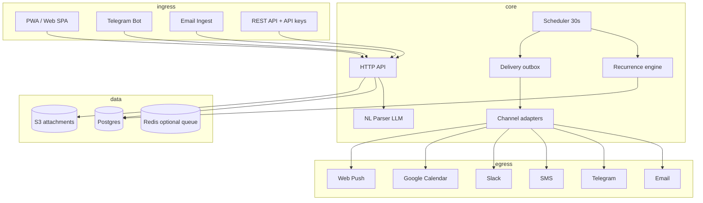

# Day Remind — Product & Technical Design (Expanded)

**Date:** 2026-09-11 (rev 4)  
**Repo (proposed):** `day-remind`  
**Status:** draft — pending user review  
**UI design:** [`2026-09-11-day-remind-ui-design.md`](./2026-09-11-day-remind-ui-design.md)

## Problem

People forget important dates and tasks scattered across notes, calendars, chat apps, and memory. They need one place to capture reminders — with rich context — and receive them through **their** preferred channels, at the right time, with advance notice, recurrence, and collaboration when needed.

## Vision

**Day Remind** is a full-featured reminder platform: create reminders via web, mobile PWA, Telegram, email ingest, or natural language; organize with tags, lists, and priorities; notify across many channels with per-reminder overrides; share with family or teams; and sync with external calendars.

---

## Feature map by release

### Tier 0 — Foundation (MVP)

Core loop: create → schedule → deliver → act.

| Area | Features |
|------|----------|
| **Auth** | Email/password signup, session cookies, password reset, profile (name, avatar, timezone) |
| **Reminders** | Title, description (markdown), due date + time, timezone-aware |
| **Actions** | Mark done, cancel, **pause / resume** (per reminder), snooze presets (+15m, +1h, +3h, tomorrow 9am, custom) |
| **Pause** | Pause single reminder; **vacation mode** pauses all notifications until a date |
| **Views** | List (upcoming / overdue / done), quick-add bar |
| **Channels** | Email (Resend), Telegram bot (link account, inline Done/Snooze) |
| **Prefs** | Global channel toggles, quiet hours, default snooze duration |
| **Reliability** | Delivery outbox, idempotency, 3 retries, delivery log per reminder |
| **Telegram bot** | `/add`, `/list`, `/done`, `/snooze`, `/help` — full CRUD from chat |

### Tier 1 — Power user

| Area | Features |
|------|----------|
| **Recurrence** | Daily, weekly, weekdays, monthly, yearly, custom interval; RRULE storage; “end after N” or “until date”; edit-this vs edit-series |
| **Advance alerts** | Multiple offsets per reminder: e.g. 1 week + 1 day + 1 hour + at time; each offset can use different channels |
| **Organization** | Tags (multi), colored **lists** (Personal, Work, Bills…), priority (low → urgent), pin to top |
| **Subtasks** | Checklist inside a reminder; optional “done only when all subtasks complete” |
| **Search & filter** | Full-text on title/description; filter by tag, list, priority, date range, status |
| **Calendar UI** | Month + week views; drag to reschedule; dot indicators for density |
| **More channels** | Web push (PWA), SMS (Twilio), Slack webhook, Discord webhook |
| **Per-reminder channels** | Override global prefs: “this one email only” or “Telegram + SMS for urgent” |
| **Templates** | Built-in (Birthday, Bill, Medicine, Meeting) + user-saved templates |
| **Attachments** | Link URL + optional file upload (S3); shown in notification |
| **Import / export** | **JSON** full backup/restore; CSV bulk import; iCal (.ics) import + export (subscribe URL) |
| **OAuth** | Sign in with **Google (Gmail account)** |
| **Gmail sync** | Connect Gmail; optional label/starred → reminder import; **pause/resume sync** independently of notifications |
| **API keys** | Personal API token for `POST /api/reminders` automation |
| **Dashboard** | Widgets: overdue count, today’s count, next 5, completion streak |

### Tier 2 — Smart & social

| Area | Features |
|------|----------|
| **Natural language** | “Remind me to pay rent on 1st at 10am every month” → parsed reminder (Gemini/Groq) |
| **Email ingest** | Forward email to `remind+token@dayremind.app` → creates reminder from subject/body |
| **WhatsApp** | Meta Cloud API channel (opt-in, template messages) |
| **Escalation** | Channel fallback chain: Telegram fail → SMS → email |
| **Sharing** | Share reminder with another user (view / edit); accept via invite link |
| **Groups** | Family or team workspace; shared lists; assignee on reminder |
| **Comments** | Thread on shared reminders |
| **Google sync** | **Gmail + Calendar** under one Google connection; two-way calendar sync; Gmail label ingest; per-integration **pause** |
| **Smart suggestions** | “You usually remind about X on Fridays” — suggest create |
| **Birthday book** | Contacts with DOB; auto yearly recurrence + advance alert |
| **Location** | Optional “remind when I arrive” (geofence via mobile PWA — future native) |
| **Voice note** | Attach short audio; transcribe for search (optional LLM) |
| **Digest** | Daily morning Telegram/email: “Today you have 4 reminders” |
| **Analytics** | Personal stats: completion rate, avg snooze, busiest day |

### Tier 3 — Platform

| Area | Features |
|------|----------|
| **Mobile apps** | Flutter or React Native client (shared API) |
| **Public API** | Webhooks on reminder done/overdue; Zapier/Make integration |
| **Admin console** | User management, delivery metrics, channel health |
| **Multi-language** | UI i18n (en, hi, …); locale-aware date formatting |
| **2FA** | TOTP + backup codes |
| **Plans** | Free (50 active reminders) vs Pro (unlimited, WhatsApp, groups) |
| **White-label** | Custom domain + branding for teams |

---

## User stories (expanded)

| ID | Story | Tier |
|----|-------|------|
| U1 | Create reminder with title, description, date, time | 0 |
| U2 | Choose global and per-reminder notification channels | 0–1 |
| U3 | Receive notification at due time on enabled channels | 0 |
| U4 | Snooze with presets or custom datetime | 0 |
| U5 | List + calendar views of reminders | 0–1 |
| U6 | Connect Telegram; manage reminders from bot | 0 |
| U7 | Quiet hours — defer non-urgent to next window | 0 |
| U8 | Recurring reminder (weekly standup, monthly bill) | 1 |
| U9 | Alert 1 day and 1 hour before main due time | 1 |
| U10 | Tag and list organization; priority sorting | 1 |
| U11 | Subtasks checklist on a reminder | 1 |
| U12 | Import birthdays CSV; export all to iCal | 1 |
| U13 | Type natural language in quick-add; AI parses | 2 |
| U14 | Share reminder with spouse; both get notified | 2 |
| U15 | Morning digest of today’s reminders | 2 |
| U16 | Forward email to create reminder | 2 |
| U17 | Google Calendar shows Day Remind items | 2 |
| U18 | API key + webhook when reminder overdue | 3 |
| U19 | Pause a reminder — no fires until I resume | 0 |
| U20 | Vacation mode — pause **all** notifications until a date | 0 |
| U21 | Pause an entire list (e.g. “Work” while on leave) | 1 |
| U22 | Connect Gmail; sync calendar + import starred/label emails as reminders | 1–2 |
| U23 | Pause Gmail or Calendar sync without disconnecting Google | 1–2 |
| U24 | Export everything to JSON; import on new device with merge options | 1 |
| U25 | Scheduled auto-export JSON to email (weekly backup) | 2 |

---

## Architecture

### Recommended: Modular monolith → worker split

**Phase 1:** Single Go binary (API + scheduler + senders + embedded SPA).  
**Phase 2:** Extract `cmd/worker` when delivery volume or channel count grows.



### Key subsystems

| Subsystem | Responsibility |
|-----------|----------------|
| **Reminder service** | CRUD, status transitions, recurrence instance generation |
| **Schedule engine** | Finds due items: main due, advance offsets, snoozed, recurring next occurrence |
| **Recurrence engine** | RRULE parse/expand; materialize next `reminder_occurrence` rows |
| **Notification router** | Resolves channels (global + per-reminder + per-offset); quiet hours; escalation |
| **Channel adapters** | Pluggable `Sender` interface per channel |
| **Share service** | ACL on reminders; invite tokens; group membership |
| **Ingest** | Email parser, NL parser, CSV/iCal importers |
| **Sync** | Google Calendar OAuth + push/pull |

---

## Data model (expanded)

### `users`

| Column | Type | Notes |
|--------|------|-------|
| id | UUID PK | |
| email | TEXT UNIQUE | |
| password_hash | TEXT | nullable if OAuth-only |
| display_name | TEXT | |
| avatar_url | TEXT | |
| timezone | TEXT | IANA |
| locale | TEXT | default `en` |
| morning_digest_enabled | BOOLEAN | Tier 2 |
| morning_digest_time | TIME | default 08:00 local |
| email_ingest_token | TEXT UNIQUE | Tier 2 |
| notifications_paused | BOOLEAN | vacation mode — no outbound notifications |
| notifications_paused_until | TIMESTAMPTZ nullable | auto-resume notifications |
| created_at | TIMESTAMPTZ | |

### `lists`

| Column | Type | Notes |
|--------|------|-------|
| id | UUID PK | |
| user_id | UUID FK | owner |
| group_id | UUID FK nullable | shared list |
| name | TEXT | |
| color | TEXT | hex |
| sort_order | INT | |
| paused | BOOLEAN | Tier 1 — pause all reminders in list |
| paused_at | TIMESTAMPTZ nullable | |

### `tags`

| Column | Type | Notes |
|--------|------|-------|
| id | UUID PK | |
| user_id | UUID FK | |
| name | TEXT | UNIQUE per user |

### `reminders`

| Column | Type | Notes |
|--------|------|-------|
| id | UUID PK | |
| user_id | UUID FK | owner |
| list_id | UUID FK nullable | |
| title | TEXT | max 200 |
| description | TEXT | markdown, max 10k |
| due_at | TIMESTAMPTZ | main due (UTC) |
| timezone | TEXT | snapshot at create |
| status | TEXT | `scheduled` \| `paused` \| `done` \| `cancelled` |
| paused_at | TIMESTAMPTZ nullable | set when paused |
| resume_at | TIMESTAMPTZ nullable | optional auto-resume |
| priority | TEXT | `low` \| `normal` \| `high` \| `urgent` |
| pinned | BOOLEAN | |
| recurrence_rule | TEXT nullable | RRULE |
| recurrence_end | TIMESTAMPTZ nullable | |
| series_id | UUID nullable | links recurring siblings |
| assignee_id | UUID nullable | Tier 2 |
| location_lat/lng/radius_m | nullable | Tier 2 geofence |
| snoozed_until | TIMESTAMPTZ nullable | |
| completed_at | TIMESTAMPTZ nullable | |
| created_at / updated_at | TIMESTAMPTZ | |

### `reminder_tags` — M2M

### `subtasks`

| id, reminder_id, title, done, sort_order |

### `reminder_offsets` (advance alerts)

| Column | Type | Notes |
|--------|------|-------|
| id | UUID PK | |
| reminder_id | UUID FK | |
| offset_minutes | INT | e.g. 1440 = 1 day before |
| channel_override | JSONB nullable | `{"telegram":true,"email":false}` |

### `reminder_occurrences` (materialized fires)

| Column | Type | Notes |
|--------|------|-------|
| id | UUID PK | |
| reminder_id | UUID FK | |
| fire_at | TIMESTAMPTZ | due or offset time |
| kind | TEXT | `main` \| `advance` \| `snooze` |
| status | TEXT | `pending` \| `fired` \| `skipped` |

### `reminder_deliveries` (outbox)

| id, occurrence_id, reminder_id, channel, status, attempt_count, last_error, sent_at, idempotency_key |

Idempotency: `{occurrence_id}:{channel}`.

### `user_notification_prefs`

| user_id, channel, enabled, address, quiet_start, quiet_end, escalation_order INT |

### `reminder_channel_overrides`

| reminder_id, channel, enabled |

### `reminder_shares` (Tier 2)

| reminder_id, shared_with_user_id, permission `view` \| `edit` |

### `groups` / `group_members`

| workspace for family/team |

### `attachments`

| reminder_id, kind `link` \| `file`, url, s3_key, filename |

### `api_keys` / `webhook_endpoints`

| Tier 3 automation |

### `templates`

| user_id nullable (null = system), name, title_template, description_template, default_offsets, default_tags |

### `google_integrations`

| Column | Type | Notes |
|--------|------|-------|
| id | UUID PK | |
| user_id | UUID FK UNIQUE | one Google account per user |
| google_email | TEXT | connected Gmail address |
| refresh_token_enc | TEXT | encrypted at rest |
| calendar_sync_enabled | BOOLEAN | push/pull calendar |
| calendar_sync_paused | BOOLEAN | pause calendar sync only |
| gmail_sync_enabled | BOOLEAN | import from Gmail labels |
| gmail_sync_paused | BOOLEAN | pause Gmail ingest only |
| gmail_label_ids | TEXT[] | e.g. `STARRED`, `IMPORTANT`, custom label ids |
| calendar_id | TEXT | default `primary` |
| last_calendar_sync_at | TIMESTAMPTZ | |
| last_gmail_sync_at | TIMESTAMPTZ | |
| gmail_history_id | TEXT | Gmail API push cursor |

### `google_event_map` / `gmail_message_map`

| Maps `reminder_id` ↔ Google event id or Gmail message/thread id for dedup on sync |

### `export_jobs` (Tier 2)

| user_id, kind `json`, status, download_url, created_at — optional scheduled backup |

---

## Pause behavior (detailed)

Reminders do not fire when **any** of these is true:

1. Reminder `status = paused`
2. Parent list `paused = true`
3. User `notifications_paused = true` (and `now() < notifications_paused_until` if set)
4. Reminder is `done` or `cancelled`

**Paused vs snoozed:** snooze moves the next fire time; pause suppresses **all** fires until resume (occurrences stay `pending`, not skipped).

**UI controls:**

| Control | Scope | API |
|---------|-------|-----|
| Pause / Resume | Single reminder | `POST /api/reminders/{id}/pause`, `/resume` |
| Pause list | All reminders in list | `POST /api/lists/{id}/pause`, `/resume` |
| Vacation mode | All notifications | `POST /api/me/notifications/pause` `{ until?: "..." }` |
| Pause Gmail sync | Gmail ingest only | `POST /api/integrations/google/gmail/pause` |
| Pause Calendar sync | Calendar push/pull only | `POST /api/integrations/google/calendar/pause` |

Telegram: `/pause <id>`, `/resume <id>`, `/vacation 7d`.

---

## Gmail & Google sync (detailed)

Single **Connect Google** OAuth (`openid`, `email`, `calendar`, `gmail.readonly`).

| Direction | Source | Target | Notes |
|-----------|--------|--------|-------|
| Push | Day Remind reminder | Google Calendar event | Title, description, due, recurrence |
| Pull | Google Calendar event | Day Remind reminder | User picks: all events or only matching keyword |
| Pull | Gmail messages (labels) | Day Remind reminder | Subject → title, snippet → description; optional LLM date extract |
| Link | Existing reminder | Gmail thread | Store `gmail_thread_id` on reminder |

**Gmail ingest rules (user-configurable):**

- Sync labels: Starred, Important, or custom labels (multi-select)
- Only unread, or all in label
- Poll every 15 min + Gmail `watch` push (Pub/Sub) when configured
- Dedup by `gmail_message_id` in `gmail_message_map`
- **Pause Gmail sync** — stops poll/watch processing; connection stays; badge “Gmail sync paused” in settings

**Calendar sync pause** — stops push/pull jobs; existing Google events remain; no new writes until resumed.

---

## JSON export / import format

**Schema version:** `day_remind_export_v1`

```json
{
  "schema_version": "day_remind_export_v1",
  "exported_at": "2026-09-11T12:00:00Z",
  "app": "day-remind",
  "user": { "email": "...", "timezone": "Asia/Kolkata", "display_name": "..." },
  "lists": [{ "id": "...", "name": "Personal", "color": "#3b82f6", "paused": false }],
  "tags": [{ "id": "...", "name": "bills" }],
  "templates": [],
  "reminders": [{
    "id": "...",
    "title": "Pay rent",
    "description": "...",
    "due_at": "2026-10-01T10:00:00+05:30",
    "timezone": "Asia/Kolkata",
    "status": "scheduled",
    "priority": "high",
    "list_id": "...",
    "tag_ids": ["..."],
    "recurrence_rule": "FREQ=MONTHLY",
    "offsets": [{ "offset_minutes": 1440 }],
    "subtasks": [{ "title": "Check amount", "done": false }],
    "channel_overrides": { "telegram": true, "email": false },
    "external_refs": { "google_event_id": "...", "gmail_message_id": "..." }
  }],
  "notification_prefs": [{ "channel": "telegram", "enabled": true }],
  "settings": { "quiet_hours": { "start": "22:00", "end": "08:00" }, "morning_digest_enabled": true }
}
```

**Excludes (security):** passwords, API keys, OAuth refresh tokens, Telegram chat tokens.

### Import modes

| Mode | Behavior |
|------|----------|
| `merge` | Insert new ids; skip reminders whose `id` already exists |
| `merge_update` | Upsert by `id` — update existing reminders |
| `replace` | Delete all user reminders/lists/tags first, then import (confirm dialog) |

**API:**

| Method | Path | Body |
|--------|------|------|
| GET | `/api/export/json` | — download attachment |
| POST | `/api/export/json/email` | send backup to user email (Tier 2) |
| POST | `/api/import/json` | multipart file or raw JSON + `?mode=merge` |
| GET | `/api/import/json/preview` | POST body → counts + conflicts without writing |

**UI:** Settings → **Data** tab: Export JSON, Import JSON (drag-drop), last export timestamp.

Also retain CSV + iCal on same page for interoperability.

---

## API surface (full)

### Auth & profile

| Method | Path | Tier |
|--------|------|------|
| POST | `/api/auth/signup`, `/login`, `/logout` | 0 |
| POST | `/api/auth/forgot-password`, `/reset-password` | 0 |
| GET/PATCH | `/api/me` | 0 |
| GET/POST | `/api/auth/google` | 1 |

### Reminders

| Method | Path | Tier |
|--------|------|------|
| GET/POST | `/api/reminders` | 0 |
| GET/PATCH/DELETE | `/api/reminders/{id}` | 0 |
| POST | `/api/reminders/{id}/done`, `/snooze`, `/cancel`, `/pause`, `/resume` | 0 |
| POST | `/api/me/notifications/pause`, `/resume` | 0 |
| POST | `/api/reminders/parse` — NL body `{ "text": "..." }` | 2 |
| GET/POST | `/api/reminders/{id}/subtasks` | 1 |
| GET/PUT | `/api/reminders/{id}/offsets` | 1 |
| GET/PUT | `/api/reminders/{id}/channels` | 1 |
| POST | `/api/reminders/{id}/share` | 2 |
| GET | `/api/reminders/{id}/deliveries` | 0 |
| POST | `/api/reminders/bulk` — CSV import | 1 |

### Organization

| GET/POST/PATCH/DELETE | `/api/lists`, `/api/tags` | 1 |
| GET/POST/DELETE | `/api/templates` | 1 |

### Calendar & export

| GET | `/api/calendar?from=&to=` — aggregated for UI | 1 |
| GET | `/api/export/ical` — subscribe token URL | 1 |
| GET | `/api/export/json` | 1 |
| POST | `/api/import/json` | 1 |
| POST | `/api/import/json/preview` | 1 |

### Integrations

| GET/PUT | `/api/notification-prefs` | 0 |
| POST | `/api/integrations/telegram/link` | 0 |
| POST | `/api/webhooks/telegram` | 0 |
| GET/POST/DELETE | `/api/integrations/google` — connect, status, disconnect | 1 |
| POST | `/api/integrations/google/sync` — manual sync now | 1 |
| POST | `/api/integrations/google/gmail/pause`, `/resume` | 1 |
| POST | `/api/integrations/google/calendar/pause`, `/resume` | 1 |
| GET/PUT | `/api/integrations/google/gmail/settings` — label filters | 2 |
| GET/POST/DELETE | `/api/api-keys` | 1 |
| GET/POST | `/api/webhooks` | 3 |

### Groups (Tier 2)

| `/api/groups`, `/api/groups/{id}/members`, `/api/groups/{id}/reminders` |

### Stats

| GET | `/api/stats/dashboard` | 1 |
| GET | `/api/stats/analytics` | 2 |

### App (Bearer)

| `POST /api/app/v1/...` | Mobile/PWA parity plane (mirror expense-bot pattern) | 2 |

---

## Notification channels

| Channel | Tier | Provider | Notes |
|---------|------|----------|-------|
| Email | 0 | Resend | HTML template, action links |
| Telegram | 0 | Bot API | Inline keyboards, bot commands |
| Web push | 1 | Web Push + VAPID | PWA service worker |
| SMS | 1 | Twilio | Opt-in; per-country |
| Slack | 1 | Incoming webhook | Per-user webhook URL |
| Discord | 1 | Webhook | |
| WhatsApp | 2 | Meta Cloud API | Template messages |
| In-app | 0 | DB notifications table | Bell icon in UI |
| Google Calendar | 2 | Calendar API | Event sync, not push per se |

**Escalation (Tier 2):** If channel A fails after retries, enqueue channel B per user’s `escalation_order`.

**Rich actions in notifications:** Done, Snooze, Open in app, Complete subtask (deep link).

---

## Web & mobile UI

> **Full UI spec:** screen wireframes, design tokens, component library, responsive rules, and flows are in [`2026-09-11-day-remind-ui-design.md`](./2026-09-11-day-remind-ui-design.md).

### Summary

| View | Tier | Description |
|------|------|-------------|
| **Today** (home) | 0 | Overdue strip, timeline, upcoming, stats, FAB |
| **All reminders** | 0 | Filter chips, search, bulk actions, card/table |
| **Calendar** | 1 | Month/week grid, drag reschedule, day panel |
| **Create/Edit drawer** | 0 | Progressive form; sheet on mobile |
| **Reminder detail** | 0 | Tabs: Details, Notifications, Activity |
| **Lists** | 1 | Color cards, pause list |
| **Templates** | 1 | Gallery → pre-filled create |
| **Settings hub** | 0 | Card grid → Profile, Channels, **Vacation**, **Google/Gmail**, **Data**, API, Appearance |
| **Command palette** | 1 | `Cmd+K` search + actions |
| **Onboarding** | 0 | 3-step coach marks first login |

### UX highlights (from UI spec)

- **Brand:** “Bell Amber” accent (`#f5a623`); dark default + light theme
- **Nav:** Sidebar desktop; bottom tab bar + FAB on mobile
- **Pause UX:** Vacation banner, pause icons, dedicated Settings → Vacation page
- **Data UX:** Drag-drop JSON import with preview; export JSON/CSV/iCal cards
- **Google UX:** Single connect card; per-sync pause toggles; label multi-select
- **A11y:** WCAG AA, focus traps, 44px touch targets, reduced-motion support
- **PWA:** manifest, service worker, install prompt

---

## Telegram bot commands (Tier 0+)

| Command | Action |
|---------|--------|
| `/start` | Link account |
| `/add <text>` | Quick add (NL in Tier 2) |
| `/list [today\|week\|overdue]` | List reminders |
| `/done <id>` | Mark done |
| `/snooze <id> [1h\|tomorrow]` | Snooze |
| `/settings` | Channel prefs summary |
| `/digest` | Toggle morning digest |
| `/pause`, `/resume` | Pause/resume reminder by id |
| `/vacation` | Pause all notifications (`/vacation 7d`) |

---

## Security & compliance

- bcrypt passwords; optional 2FA (Tier 3)
- Session + API key auth; keys hashed at rest
- Rate limits: auth 10/min, create 60/min per user
- All queries scoped by owner or share ACL
- SMS/WhatsApp: store consent timestamp
- Attachment virus scan hook (ClamAV or cloud) — Tier 1
- GDPR: export all data JSON; delete account cascades
- Audit log for share/access changes (Tier 2)

---

## Tech stack

| Layer | Choice |
|-------|--------|
| Backend | Go 1.22+, chi router |
| DB | Postgres 16 |
| Cache/queue (optional) | Redis for worker queue at scale |
| Object storage | S3-compatible (attachments) |
| LLM | Gemini → Groq fallback (NL parse, email ingest) |
| Email | Resend |
| SMS | Twilio |
| UI | Embedded SPA (Bootstrap 5 + vanilla JS); PWA |
| Mobile (later) | Flutter sharing `/api/app/v1` |
| Deploy | Docker, GHCR, Caddy TLS |

---

## Phased delivery (expanded)

| Phase | Tier | Outcome |
|-------|------|---------|
| **0** Scaffold | — | Repo, CI, Postgres, health |
| **1** Core | 0 | Auth, reminder CRUD, list UI, Telegram link |
| **2** Delivery | 0 | Scheduler, email + Telegram send, snooze, bot commands |
| **3** Organization | 1 | Tags, lists, priority, search, calendar month view |
| **4** Recurrence & offsets | 1 | RRULE, advance alerts, subtasks |
| **5** More channels | 1 | Web push, SMS, Slack, per-reminder channel override |
| **6** Import/export | 1 | **JSON**, CSV, iCal, templates, API keys |
| **6b** Pause | 0–1 | Reminder/list/vacation pause; scheduler respects all gates |
| **7** Google (Gmail) | 1–2 | OAuth, calendar sync, Gmail label ingest, sync pause |
| **8** Smart | 2 | NL parse, email ingest, digest, escalation, weekly JSON backup email |
| **9** Social | 2 | Share, groups, comments |
| **9** Platform | 3 | Webhooks, admin, 2FA, billing hooks |

---

## Success metrics

| Metric | Target |
|--------|--------|
| Delivery latency (p95) | &lt; 60s after fire_at |
| Delivery success | &gt; 99% per channel |
| Duplicate sends | 0 (idempotency) |
| NL parse accuracy | &gt; 90% on benchmark set (Tier 2) |
| Week-1 retention | &gt; 40% users with ≥3 reminders |

---

## Open decisions

1. Standalone repo vs monorepo sibling?
2. Auth: email-first, Google OAuth in Tier 1, Telegram-only accounts?
3. Free tier limits (50 active reminders?) vs unlimited Pro?
4. First mobile: PWA only or Flutter app in Tier 2?
5. Hosting: OCI VM vs Fly + managed Postgres?
