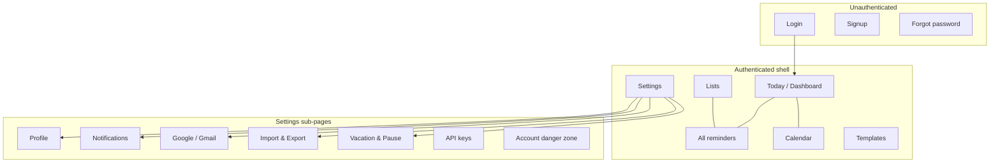
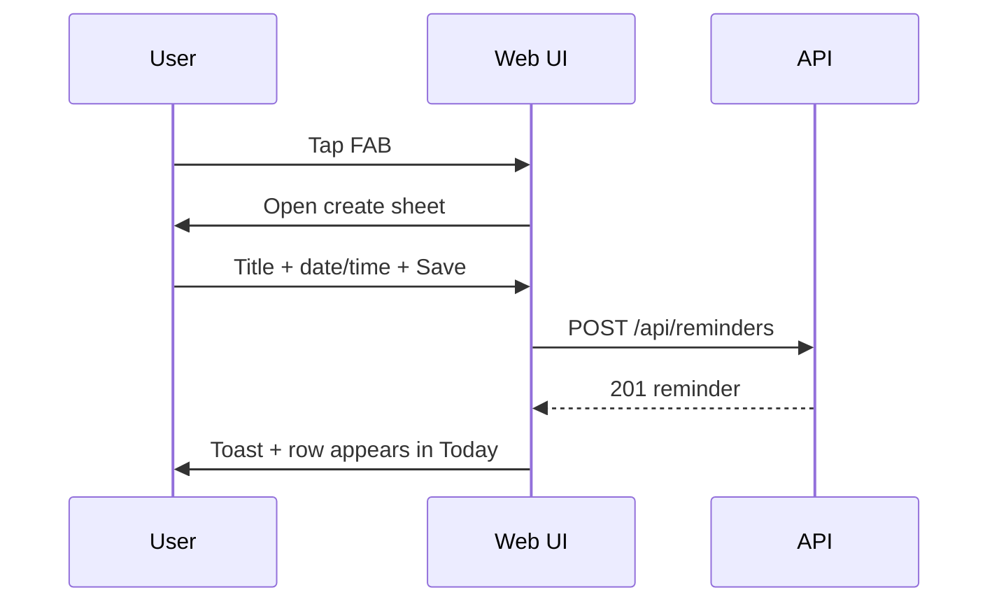

# Day Remind — UI Design Specification

**Date:** 2026-09-11  
**Parent:** [`2026-09-11-day-remind-design.md`](./2026-09-11-day-remind-design.md)  
**Status:** draft — pending user review

## Design intent

Day Remind should feel **calm, trustworthy, and time-aware** — closer to a personal clock than a corporate admin panel. Users open it to see *what’s next*, act in one tap, and leave. Density is medium: more information than a minimal todo app, less than expense-bot admin.

**Personality keywords:** clear · warm · punctual · unobtrusive

**Anti-patterns:** noisy gradients, gamification overload, modal-heavy flows, tiny touch targets, calendar grids that break on mobile.

---

## Design principles

| # | Principle | Implementation |
|---|-----------|----------------|
| 1 | **Glanceable** | Today + overdue visible without scroll on phone |
| 2 | **One-thumb mobile** | Primary actions bottom-right FAB or sticky bar |
| 3 | **Time is hero** | Due time larger than title on list rows; color encodes urgency |
| 4 | **Pause is visible** | Paused items grey + pause icon; vacation banner non-dismissible |
| 5 | **Channel clarity** | Small channel icons on each row (email, TG, SMS…) |
| 6 | **Progressive disclosure** | Simple create form default; “More options” expands recurrence, offsets, channels |
| 7 | **Accessible** | WCAG 2.1 AA contrast; focus rings; no color-only status |

---

## Visual design system

### Color palette

**Brand accent — “Bell Amber”** (warm reminder, not alarm-red):

| Token | Dark | Light | Use |
|-------|------|-------|-----|
| `--accent` | `#f5a623` | `#e09400` | Primary CTA, active nav, calendar today |
| `--accent-soft` | `rgba(245,166,35,.14)` | `rgba(224,148,0,.12)` | Selected row, chip bg |
| `--accent-2` | `#7cacf8` | `#2563eb` | Links, secondary actions |

**Neutrals (dark default):**

| Token | Value |
|-------|-------|
| `--bg` | `#0f1219` |
| `--surface` | `#171b26` |
| `--surface-2` | `#1e2433` |
| `--surface-3` | `#262d40` |
| `--border` | `#2e3649` |
| `--text-1` | `#eef1f6` |
| `--text-2` | `#a8b0c4` |
| `--text-3` | `#6b758c` |

**Semantic:**

| Role | Color | Soft bg |
|------|-------|---------|
| Overdue | `--danger` `#f07178` | `--danger-soft` |
| Due today | `--accent` | `--accent-soft` |
| Upcoming | `--info` `#7cacf8` | `--info-soft` |
| Done | `--success` `#6bcf7f` | `--success-soft` |
| Paused | `--text-3` | `--surface-3` |

**Priority dots** (left border or dot, not only color):

| Priority | Border | Icon |
|----------|--------|------|
| Low | 2px `#6b758c` | — |
| Normal | none | — |
| High | 2px `#f5a623` | `!` in meta |
| Urgent | 2px `#f07178` + pulse animation (respect `prefers-reduced-motion`) | `!!` |

**List colors:** user picks from 8 presets; shown as left stripe on reminder cards.

### Typography

System stack (no external fonts — PWA-friendly):

```css
--font: system-ui, -apple-system, "Segoe UI", Roboto, "Helvetica Neue", sans-serif;
--mono: ui-monospace, "SF Mono", Menlo, Consolas, monospace;
```

| Scale | Size | Use |
|-------|------|-----|
| `--type-2xl` | clamp(1.5rem, 4vw, 2rem) | Page titles |
| `--type-xl` | 1.25rem | Section heads |
| `--type-lg` | 1.0625rem | Reminder title |
| `--type-base` | 1rem | Body |
| `--type-sm` | 0.875rem | Meta, labels |
| `--type-xs` | 0.75rem | Badges, timestamps |

**Due time** on list rows: `--type-lg` + `--mono` tabular nums.

### Spacing & layout tokens

```css
--sp-1: 4px;  --sp-2: 8px;  --sp-3: 12px;  --sp-4: 16px;
--sp-5: 24px; --sp-6: 32px; --sp-7: 48px; --sp-8: 64px;
--radius-sm: 6px; --radius: 10px; --radius-lg: 16px;
--sidebar-w: 240px;        /* desktop nav */
--bottom-nav-h: 56px;      /* mobile */
--fab-size: 56px;
--page-max-w: 1200px;
--drawer-w: min(420px, 100vw);
```

### Motion

| Token | Value | Use |
|-------|-------|-----|
| `--dur-fast` | 120ms | Hover, toggle |
| `--dur-normal` | 200ms | Drawer slide |
| `--dur-slow` | 320ms | Page fade |
| `--ease` | `cubic-bezier(0.22, 1, 0.36, 1)` | Entrances |

Honor `prefers-reduced-motion`: disable pulse, drawer slide → instant.

### Icons

Vendored **Bootstrap Icons** subset (inline SVG sprites) — bell, calendar, pause, play, tag, list, telegram, mail, etc. No icon font CDN.

---

## Information architecture



### Navigation model

| Viewport | Pattern |
|----------|---------|
| **Desktop ≥1024px** | Left sidebar (logo, nav, lists shortcut, user menu) + main content |
| **Tablet 768–1023px** | Collapsible sidebar icon rail OR top tabs |
| **Mobile &lt;768px** | Bottom tab bar: **Today · Calendar · Lists · Settings** + center FAB “Add” |

**Global elements (all authenticated pages):**

- Top bar: page title, search icon (opens overlay), notification bell (in-app)
- Vacation mode banner (full width, amber, when active)
- Quick-add: `Ctrl/Cmd+K` or `/` opens command palette (Tier 1)

---

## Screen specifications

### 1. Login / Signup

**Layout:** Split screen ≥900px — left brand panel (bell illustration + tagline “Never miss what matters”), right form card. Mobile: stacked, brand compact header.

**Login form:** Email, password (show/hide toggle), “Sign in”, link to signup, **“Continue with Google”** outline button (Tier 1).

**Signup:** Name, email, password, timezone auto-detect, T&C checkbox.

**States:** Inline validation, shake on error, spinner on submit, `aria-busy`.

```
┌─────────────────────────────────────────────────────────┐
│  🔔 Day Remind          │   Sign in                     │
│  Reminders that reach   │   ┌─────────────────────┐     │
│  you — your way.        │   │ Email               │     │
│                         │   │ Password      [👁]  │     │
│  ✓ Multi-channel        │   │ [ Sign in ]         │     │
│  ✓ Gmail sync           │   │ ─── or ───          │     │
│  ✓ Pause anytime        │   │ [ G  Google ]       │     │
│                         │   └─────────────────────┘     │
└─────────────────────────────────────────────────────────┘
```

---

### 2. Today (Dashboard) — default home

**Purpose:** Answer “What do I need to deal with right now?”

**Sections (top → bottom):**

1. **Vacation banner** (conditional) — “Notifications paused until Sep 20” + Resume link
2. **Overdue strip** (red-soft bg) — count + horizontal scroll cards OR collapsed “3 overdue” tap to expand
3. **Greeting + date** — “Good morning, Shivam” + “Thursday, 11 Sep”
4. **Today timeline** — vertical list grouped by time (Morning / Afternoon / Evening / No time)
5. **Upcoming** — next 7 days compact list (max 5, “View all”)
6. **Quick stats row** — 4 mini cards: Today · This week · Paused · Done this week

**FAB (mobile):** `+` opens create sheet.

**Empty state:** Illustration + “No reminders today” + CTA “Create your first reminder” + template chips (Birthday, Bill…).

```
┌─ Sidebar ─┬─ Today ─────────────────────────────────────┐
│ Today ●   │ Good morning, Shivam        🔍  🔔          │
│ Calendar  │ ┌─ Overdue ─────────────────────────────────┐│
│ Lists     │ │ ⚠ Pay electricity — was yesterday  [Done]││
│ Templates │ └──────────────────────────────────────────┘│
│ Settings  │                                             │
│           │ Today · 11 Sep                              │
│ ─ Lists ─ │  09:00  Team standup          📧 ✈️  [···]  │
│ ● Personal│  14:30  Dentist appointment    📧 📱  [···]  │
│   Work    │  18:00  Call mom               ✈️      [···]  │
│           │                                             │
│           │ Upcoming                                    │
│           │  Tomorrow — Submit report                   │
└───────────┴─────────────────────────────────────────────┘
                                                      [ + ]
```

---

### 3. All reminders (list view)

**Toolbar:** Filter chips — All | Scheduled | Paused | Done | Overdue. Search. Sort: Due date · Priority · Created.

**Row anatomy:**

```
│ ▌ │ 14:30  Today      Team standup              📧 ✈️  ⏸ │
│ ▌ │        Personal · high                         [···] │
```

- Left color stripe = list color
- Pause icon when paused
- Channel icons (muted if disabled for that reminder)
- `···` menu: Edit, Snooze, Pause, Done, Delete

**Bulk actions (desktop):** checkbox select → Done / Pause / Delete bar.

**Table → cards** at ≤768px (stacked card per reminder).

---

### 4. Calendar view

**Month grid (default):**

- 7-column grid, Mon–Sun (user pref Sun-start optional)
- Dot density per day (max 3 dots + “+2”)
- Today ring in `--accent`
- Days with overdue: subtle red dot under number

**Week view:** Time grid 6am–10pm, events as blocks; drag block to reschedule.

**Side panel (desktop) / bottom sheet (mobile):** Click day → list reminders that day + “Add on this day”.

**Legend:** Paused (grey hatch), recurring (↻ icon).

---

### 5. Create / Edit reminder (drawer)

**Pattern:** Right drawer desktop (`--drawer-w`); full-screen sheet mobile with sticky footer actions.

**Progressive form:**

**Step A — Essentials (always visible):**

| Field | Control |
|-------|---------|
| Title | Text, autofocus, required |
| When | Date picker + time picker + timezone chip |
| List | Dropdown with color dots |
| Quick NL | Toggle “Type naturally” → single line (Tier 2) |

**Step B — More options (collapsed `<details>`):**

- Description (markdown textarea + preview tab)
- Priority segmented control
- Tags multi-select chips
- Recurrence picker (presets + custom)
- Advance alerts (+1d, +1h, custom list)
- Notification channels override toggles
- Subtasks checklist
- Attachments (link / file)
- Pause after save checkbox

**Footer:** Cancel | **Save reminder** (primary)

**Edit recurring:** Radio — This only / This and following / All in series.

---

### 6. Reminder detail (read-only drawer)

Tabs: **Details · Notifications · Activity**

- **Details:** All fields, subtasks progress, Google/Gmail link if synced
- **Notifications:** Delivery log table (channel, status, time, error)
- **Activity:** Created, edited, snoozed, paused history

**Sticky actions:** Done · Snooze ▾ · Pause/Resume · Edit · Delete

---

### 7. Lists page

Grid of list cards: color bar, name, count, paused badge. Click → filtered All reminders view. Long-press / menu: Edit, Pause list, Delete.

**Create list modal:** Name, color picker (8 swatches), icon optional.

---

### 8. Templates gallery

Card grid with emoji/icon, name, description. Click → pre-filled create drawer. “Save current as template” from create form.

---

### 9. Settings hub

**Layout:** Settings index = card grid; each card opens sub-page.

| Card | Icon | Sub-page |
|------|------|----------|
| Profile | user | Name, email, timezone, locale, avatar |
| Notifications | bell | Channel toggles, quiet hours, escalation order |
| Vacation & Pause | pause-circle | Vacation mode toggle + until date; link to paused reminders |
| Google & Gmail | google | Connect, sync status, pause per sync, label picker |
| Telegram | telegram | Link QR / deep link, bot username |
| Data | database | **Export JSON / CSV / iCal** · Import JSON drag-drop zone |
| API & automation | key | API keys, webhooks (Tier 3) |
| Appearance | palette | Theme dark/light/system, density compact/comfortable |
| Account | shield | Password, 2FA, delete account |

#### 9a. Data (Import / Export) page

```
┌─ Export ─────────────────────────────────────────┐
│  Download a backup of all your reminders.        │
│  [ Export JSON ]  [ Export CSV ]  [ Export iCal ]│
│  Last export: 10 Sep 2026, 3:42 PM               │
│  ☐ Email me a JSON backup every week (Tier 2)    │
└──────────────────────────────────────────────────┘
┌─ Import ─────────────────────────────────────────┐
│  ┌ - - - - - - - - - - - - - - - - - - - - - ┐  │
│  │  Drop JSON file here or click to browse    │  │
│  └ - - - - - - - - - - - - - - - - - - - - - ┘  │
│  Mode: (●) Merge  ( ) Merge & update  ( ) Replace│
│  [ Preview import ]  → shows counts table        │
│  [ Import ]                                      │
└──────────────────────────────────────────────────┘
```

#### 9b. Google & Gmail page

```
┌─ Connected account ──────────────────────────────┐
│  user@gmail.com          [ Disconnect ]          │
│  Calendar sync  [ON]  [Pause]  Last: 2 min ago   │
│  Gmail ingest   [ON]  [Pause]  Last: 15 min ago  │
│  Labels: ☑ Starred  ☑ Important  ☐ Work          │
│  [ Sync now ]                                    │
└──────────────────────────────────────────────────┘
```

#### 9c. Vacation & Pause page

```
┌─ Vacation mode ──────────────────────────────────┐
│  Pause ALL notifications while you're away.    │
│  [ Toggle OFF / ON ]                           │
│  Resume on: [ date picker ] [ time ]           │
│  [ Resume now ]                                │
└────────────────────────────────────────────────┘
┌─ Paused reminders (3) ─────────────────────────┐
│  · Pay rent (paused Sep 1)      [ Resume ]   │
│  · Weekly report (list: Work)     [ Resume ]   │
└────────────────────────────────────────────────┘
```

---

### 10. Command palette (Tier 1)

`Cmd+K` overlay: fuzzy search reminders + actions (“Create reminder”, “Pause vacation”, “Go to calendar”). Keyboard navigable.

---

### 11. In-app notification center

Bell dropdown: last 20 notifications (reminder fired, delivery failed, share invite). Mark read, link to reminder.

---

### 12. Onboarding (first login)

3-step coach marks (dismissible):

1. “Add your first reminder” → highlights FAB
2. “Choose how we reach you” → Settings → Channels
3. “Connect Google or Telegram” → integrations card

Stored in `localStorage` `onboarding_done`.

---

## Component library

| Component | Class / pattern | Notes |
|-----------|-----------------|-------|
| **Reminder card** | `.reminder-card` | Stripe, time, title, meta, channels, menu |
| **Time chip** | `.time-chip` | Relative “in 2h” / absolute “14:30” |
| **Status badge** | `.badge-overdue` etc. | Text + color |
| **Filter chips** | `.filter-chip` | `aria-pressed` toggle group |
| **Drawer** | `.drawer` + `.drawer-backdrop` | Focus trap, Escape close |
| **Bottom sheet** | `.sheet` | Mobile create/detail |
| **FAB** | `.fab` | Fixed bottom-right above nav |
| **Empty state** | `.empty-state` | Icon SVG, title, body, CTA |
| **Skeleton** | `.sk` | Shimmer rows while loading |
| **Toast** | `.toast` | Success/error; auto-dismiss 4s |
| **Confirm dialog** | `.dialog` | Replace `confirm()`; destructive red primary |
| **Channel icon row** | `.channel-icons` | 16px icons, `title` tooltip |
| **Pause overlay** | `.is-paused` | opacity .65 + pause badge |
| **Vacation banner** | `.vacation-banner` | Sticky below topbar |
| **Drop zone** | `.dropzone` | Dashed border, drag-over accent |
| **Sync status pill** | `.sync-pill` | ok / paused / error + last sync |

---

## Responsive breakpoints

| Breakpoint | Layout changes |
|------------|----------------|
| **≥1280px** | Sidebar + main; calendar side panel inline |
| **1024–1279px** | Sidebar narrow (icons + tooltip) |
| **768–1023px** | Sidebar → hamburger drawer |
| **&lt;768px** | Bottom nav + FAB; drawers → full sheets |
| **&lt;360px** | Single column; reduce padding; 320px floor |

**Touch targets:** minimum 44×44px on mobile for all interactive elements.

---

## Key user flows

### Flow A — Create reminder (happy path)



### Flow B — Pause vacation

1. Settings → Vacation & Pause
2. Toggle ON → pick resume date
3. Banner appears on all pages
4. Scheduler stops deliveries (backend); UI shows “paused” on dashboard

### Flow C — JSON backup & restore

1. Settings → Data → Export JSON (download)
2. Later: Import → drop file → Preview → confirm Merge → Import
3. Toast “Imported 42 reminders, skipped 3 duplicates”

### Flow D — Connect Gmail

1. Settings → Google → Connect Google (OAuth popup)
2. Return → enable Gmail ingest + pick labels
3. Sync now → toast “Imported 2 reminders from Gmail”

---

## Accessibility checklist

- [ ] Skip link to main content
- [ ] `aria-current="page"` on active nav
- [ ] All form inputs have visible `<label>` or `aria-label`
- [ ] Focus trap in drawer/dialog; restore focus on close
- [ ] Color contrast ≥ 4.5:1 body text (both themes)
- [ ] Priority/overdue not color-only (icons + text)
- [ ] `prefers-reduced-motion` respected
- [ ] Live region for toasts (`aria-live="polite"`)

---

## PWA shell

| Asset | Spec |
|-------|------|
| `manifest.json` | `name: Day Remind`, `theme_color: #f5a623`, `display: standalone` |
| Icons | 192 + 512 PNG (bell on amber/dark bg) |
| `sw.js` | Cache app shell; network-first API |
| Install prompt | Custom banner after 2nd visit |

---

## File structure (frontend)

```
internal/web/static/
├── index.html
├── manifest.json
├── sw.js
├── css/
│   ├── theme.css      # design tokens dark + light
│   └── app.css        # components + layout
├── js/
│   ├── app.js         # router, shell, pages
│   ├── reminders.js   # list, create, detail
│   ├── calendar.js    # month/week grid
│   ├── settings.js    # settings sub-pages
│   ├── components.js  # drawer, toast, dialog, chips
│   └── api.js         # fetch wrapper, credentials
├── icons/             # SVG sprites
└── vendor/
    └── bootstrap.min.css
```

**Routing:** hash-based `#/today`, `#/reminders`, `#/calendar`, `#/lists`, `#/settings/profile`, etc. (same pattern as expense-bot).

---

## QA viewports (required before each UI release)

Run manual or Playwright sweep:

| Width | Theme | Pages |
|-------|-------|-------|
| 390 | dark | Today, create sheet, settings/data |
| 390 | light | Calendar week, login |
| 768 | dark | Lists, drawer |
| 1440 | dark | Full desktop shell, import preview |

Console errors = fail. Overlap/clipping = fail.

---

## Reference mood

- **Inspiration:** Apple Reminders clarity + Linear’s density + warm accent (not cold blue SaaS)
- **Not:** Full Google Calendar complexity on day one; expense-bot admin density
